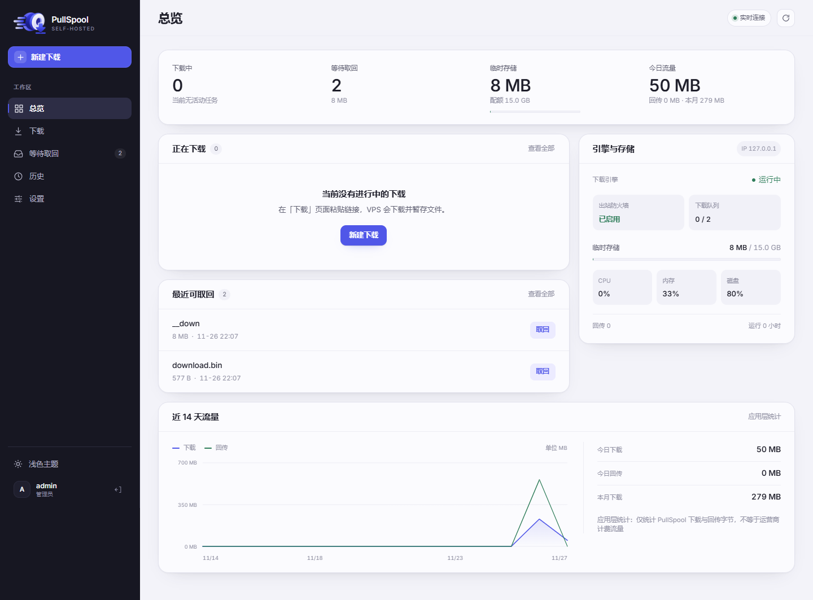
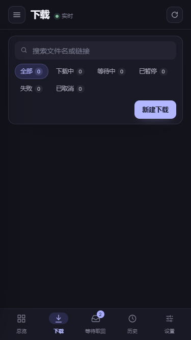

# PullSpool

**让 VPS 替你下载，再从 VPS 取回。** 一个自托管的远程下载与临时文件中转站：浏览器只和你的 VPS 通信，
目标网站由 VPS 用自己的公网出口访问，文件真实落在 VPS 磁盘，确认取回后自动删除。

> 适用场景：本地网络访问目标站点很慢/被限速、目标链接只允许服务器 IP、手机流量紧张、临时取一个大文件但不想在本地留痕。

## 项目概览

PullSpool 把“下载”和“取回”拆成两步：VPS 负责访问目标站点、下载并暂存文件；你只从自己的服务器取回结果。目标站点看到的是 VPS 的 IP，文件也不会先落到你的电脑或手机。

**适合：**

- 本地访问目标站点很慢，或被限速；
- 目标链接只允许服务器 IP 访问；
- 手机流量紧张，或只想临时取一个大文件；
- 不想让目标站点看到你的本地 IP。

**不适合：**

- 公开网盘、资源下载站、多用户分享；
- BT / 磁力 / FTP / SFTP；
- 长期归档或冷备份。

和普通“VPS 下载面板”的区别：

- 下载、SHA-256 校验、取回、删除是一条完整流程；
- aria2 在独立容器和独立出口网络中运行，后端做 SSRF 预检；
- 单用户、自托管，不依赖外部账号或云服务。

---

## 它如何工作

1. 在网页里提交一个 `http/https` 下载链接；
2. 后端做 SSRF 预检（协议、DNS、固定 IP、重定向逐跳校验），然后交给 aria2；
3. aria2 在独立容器里用 VPS 的公网出口下载，文件写入 `./data/downloads/<task-id>/`；
4. 下载完成后计算 SHA-256、校验大小，任务进入「等待取回」；
5. 你用浏览器、下载器或手机从 `https://你的VPS:18443` 取回，支持 Range 断点续传；
6. 你点击「确认取回并删除」，VPS 删除临时文件并保留校验记录；
7. 超过保留期（默认 24 小时）未取回的任务会被自动清理，避免占满磁盘。

浏览器关闭、页面刷新、网络切换都不影响第 3 步——下载在服务器上继续。

---

## 界面预览

| 总览（浅色，1440） | 下载管理（深色，375 手机） |
|---|---|
|  |  |

更多截图见 `frontend/screenshots/`（7 档宽度 × 明暗两套主题 × 5 个页面，共 74 张，含登录页、抽屉与移动菜单）。

---

## 功能

**下载**
- 新建任务：URL 校验、可选文件名/连接数/限速/大小上限
- 队列与并发：默认 2 个并发，超出排队；磁盘不足时暂停队列并提示
- 暂停 / 恢复 / 取消 / 重试 / 删除，失败原因中文化展示
- 实时进度（SSE 推送，断线自动回退轮询），速度 / 剩余时间 / 百分比
- 下载引擎异常可检测：`/api/health` 与界面「下载引擎」状态

**安全（详见 [SECURITY.md](SECURITY.md)）**
- SSRF 五层防护：URL/DNS 校验、固定 IP 预检、重定向逐跳复检、aria2 容器 iptables 出口防火墙、下载后校验
- Argon2id 密码哈希、登录锁定与限流、会话哈希存储、CSRF 校验、严格 CSP
- 文件名与路径穿越防护；下载令牌 HMAC 签名、30 分钟有效
- 容器最小暴露面：只有 Caddy 发布端口，四网络分段，非 root 运行
- 可在设置中修改登录用户名（需当前密码确认，改后当前会话保持有效）

**取回**
- 流式回传（不落内存）、Range / `If-Range` / ETag，支持下载器续传
- SHA-256 展示与校验接口；带令牌的临时下载链接
- 「确认取回并删除」幂等；有活跃回传时拒绝删除，避免误删
- 到期自动清理，磁盘配额与最低剩余空间保护

**观测**
- 下载 / 回传 / 今日 / 本月流量分开统计（**应用层统计**，不是运营商账单；统一以 MB 显示）
- 单任务流量、系统状态（CPU/内存/磁盘/队列/运行时长）、14 天流量图
- 任务事件时间线（创建、开始、完成、失败、删除等）

**界面**
- 中文界面；浅色/深色/跟随系统；舒适/紧凑两档密度
- 1920 / 1440 / 1024 / 390 / 375 / 2560 / 3840 七档响应式，2K/4K 自动放大字号、内容宽度与表格列；手机端卡片布局与底部导航
- 无 UI 框架依赖，手写 SVG 图标与设计系统（见 [docs/DESIGN.md](docs/DESIGN.md)）

---

## 一键启动（Linux VPS）

```bash
git clone <你的仓库地址> pullspool
cd pullspool
sudo sh scripts/quickstart.sh
```

脚本会自动完成：

- 从 `.env.example` 生成 `.env`
- 检测公网 IP，写入 `PUBLIC_IP / TLS_HOST / PUBLIC_BASE_URL`
- 写入当前用户的 `PULLSPOOL_UID / GID`，创建并 chown 数据目录
- 运行 `scripts/preflight.sh`
- `docker compose up -d --build`
- 等待 `/api/health`，打印访问地址、初始凭据和 CA 路径

默认是 **HTTPS internal（自签 CA）**，浏览器打开后仍需按
[INSTALL.md](INSTALL.md#7-导入-ca-根证书) 导入 `data/caddy/.../root.crt`；这一步无法由脚本代替。

常用变体：

```bash
# 使用域名 + Let's Encrypt（需要 80/443 可访问）
sudo sh scripts/quickstart.sh --domain pull.example.com --email you@example.com

# 纯 HTTP，仅限内网/SSH 隧道测试
sudo sh scripts/quickstart.sh --http --ip 203.0.113.5

# 端口被占用
sudo sh scripts/quickstart.sh --http-port 28080 --https-port 28443

# 使用 GitHub Actions 构建的 GHCR 镜像（不本地 build）
sudo sh scripts/quickstart.sh --ghcr ghcr.io/<your-github-name>
```

`--ghcr` 需要仓库的 `images` workflow 已发布镜像，并把 GitHub Packages 设为 public；
私有包先执行 `docker login ghcr.io`。`push` 一个 `v*` tag 会触发 `.github/workflows/images.yml`：

```bash
git tag v1.0.2
git push origin v1.0.2
```

### 纯镜像 Compose（发布后用）

发布镜像后，用户不需要源码，只要 [docker-compose.release.yml](docker-compose.release.yml) 和
[.env.release.example](.env.release.example)：

```bash
curl -fsSLO https://raw.githubusercontent.com/<owner>/pullspool/main/docker-compose.release.yml
curl -fsSLO https://raw.githubusercontent.com/<owner>/pullspool/main/.env.release.example
mv .env.release.example .env
# 修改 PUBLIC_IP / TLS_HOST / PUBLIC_BASE_URL（以及需要时的 GHCR tag）
chmod 600 .env

docker compose -f docker-compose.release.yml pull
docker compose -f docker-compose.release.yml up -d
```

这个文件**只有 `image:`，没有 `build:`**；Caddy 的 entrypoint 也已打进
`pullspool-caddy` 镜像，所以不需要挂载仓库里的 `docker/caddy` 文件。

许可证文件随仓库/Release 一并分发：`THIRD_PARTY_NOTICES.md`、`LICENSES/`、
`THIRD_PARTY_LICENSES/`；二创/再分发镜像时请保留。

### 面板单文件（HTTP，仅测试）

有些面板只能粘贴一个 Compose YAML，不会加载 `.env`。用
[docker-compose.panel.yml](docker-compose.panel.yml)：它没有任何 `${...}` 变量，
不需要 `.env`，默认是 HTTP：

```bash
# 面板只接受 YAML 时使用；访问 http://<VPS_IP>:18080
docker compose -f docker-compose.panel.yml up -d
```

> 这是 HTTP 明文模式，只适合首次试用/内网。生产请用
> `docker-compose.release.yml` + `env.release.example` 开 HTTPS。
> 默认账号 `admin / admin`，首次登录会强制改密。
>
> 首次部署要拉四个镜像，慢网络 3–5 分钟正常。`init` 是执行完 chown 就退出的一次性容器，
> 面板显示它 `Exited (0)` 或“部分容器运行”是正常初始化，不是启动失败。

### 手动步骤（可选）

```bash
# 1. 准备：Docker Engine 24+ 与 Compose v2（安装步骤见 INSTALL.md）
docker version && docker compose version

# 2. 取得代码（上传目录或 clone 你自己的仓库）
cd /opt/pullspool

# 3. 配置
cp .env.example .env
chmod 600 .env
#    至少修改：PUBLIC_IP / TLS_HOST / PUBLIC_BASE_URL
#    有域名时：DOMAIN、TLS_MODE=acme、HTTP_PORT=80、HTTPS_PORT=443

# 4. 检查环境（端口、磁盘、内存、TLS 配置、数据目录权限）
sudo bash scripts/preflight.sh

# 5. 启动
docker compose up -d --build

# 6. 首次登录（默认账号 / 密码：admin / admin）
sudo cat ./data/bootstrap-admin.txt   # 可选：确认初始信息
```

首次访问：`https://<你的VPS公网IP>:18443`（默认 internal CA 自签证书，需按
[INSTALL.md](INSTALL.md#7-导入-ca-根证书) 导入根证书；也可先用 `curl -k` 验证服务）。

浏览器打开后：
1. 用默认账号 `admin`、密码 `admin` 登录；
2. 系统强制修改密码，改完后 `bootstrap-admin.txt` 自动删除；
3. 到「下载」页粘贴链接，开始第一个任务。

> 默认密码只用于首次登录，且登录后无法访问其他接口。若 VPS 在首次启动时就暴露公网，
> 建议先在 `.env` 设置 `BOOTSTRAP_ADMIN_PASSWORD=<随机密码>` 再启动，避免被人抢先改密。

验证栈是否正常：

```bash
curl -k https://127.0.0.1:18443/api/health
# {"status":"ok","checks":{"db":"ok","disk":"ok","aria2":"ok","egress_guard":"ok"},...}

SMOKE_PASSWORD='你的密码' bash scripts/smoke-test.sh
```

> 只有 1 台 1C1G 的 VPS？先看 [INSTALL.md 的资源调优](INSTALL.md#10-低配-vps-调优)。

---

## 架构

```
                    Internet
                       │
       ┌───────────────┴───────────────┐
       │                               │
 18080 / 18443                  出站（egress）
       │                               │
  ┌────▼─────┐                   ┌─────▼──────┐
  │  caddy   │                   │   aria2    │
  └────┬─────┘                   │ +iptables  │
       │ edge                    └─────┬──────┘
  ┌────┴─────┐                         │ core（internal）
  │ frontend │──app──┐                 │
  └──────────┘       │                 │
                 ┌───▼──────┐◄─────────┘
                 │ backend  │──── egress ──► Internet（预检）
                 └──────────┘
```

| 服务 | 作用 | 对外端口 |
|---|---|---|
| `caddy` | TLS 终结、HTTP→HTTPS、反代 | **18080 / 18443** |
| `frontend` | nginx 托管 SPA，`/api` 反代 backend | 无 |
| `backend` | FastAPI：鉴权、任务、调度、SSRF、回传、清理 | 无 |
| `aria2` | 实际下载引擎（JSON-RPC） | 无 |

技术栈：Python 3.12 + FastAPI + SQLAlchemy 2 + SQLite（WAL）+ Alembic；aria2 1.37；
Vue 3 + TypeScript + Vite + Pinia；Caddy 2；nginx。完整设计见 [docs/ARCHITECTURE.md](docs/ARCHITECTURE.md)，
API 见 [docs/API.md](docs/API.md)，数据库见 [docs/SCHEMA.md](docs/SCHEMA.md)。

### 数据目录

```
./data/
├── db/pullspool.db          # SQLite（含会话、任务、事件、流量）
├── downloads/<task-id>/     # 临时文件，取回/过期后删除
├── aria2/                   # RPC 密钥、session、出口防火墙状态
├── caddy/data/              # Caddy 证书与 internal CA
└── bootstrap-admin.txt      # 首次启动生成，改密后删除
```

`.env` 中的 `HOST_DATA_DIR` 可改位置；升级/备份只需保住这个目录。

---

## 文档

| 文档 | 内容 |
|---|---|
| [INSTALL.md](INSTALL.md) | Linux VPS 从零安装、CA 导入、ACME、排错 |
| [UPDATE.md](UPDATE.md) | 更新与回滚 |
| [UNINSTALL.md](UNINSTALL.md) | 卸载与数据清除 |
| [BACKUP.md](BACKUP.md) | 备份、恢复、演练 |
| [SECURITY.md](SECURITY.md) | 威胁模型、控制清单、实测记录、残余风险 |
| [docs/ACCEPTANCE.md](docs/ACCEPTANCE.md) | 最终验收报告（逐条对照需求） |
| [docs/ARCHITECTURE.md](docs/ARCHITECTURE.md) | 架构、状态机、SSRF、流量统计、默认参数 |
| [docs/API.md](docs/API.md) | 34 个错误码、任务对象、端点、SSE、限流 |
| [docs/DESIGN.md](docs/DESIGN.md) | 设计系统、组件、页面结构、断点、无障碍 |
| [docs/SCHEMA.md](docs/SCHEMA.md) | 表结构、索引、PRAGMA、对账 SQL |

---

## 测试与质量

```bash
cd backend
python3 -m venv .venv && . .venv/bin/activate
pip install -r requirements-dev.txt
pytest                     # 263 passed, 1 skipped
ruff check app tests       # All checks passed
```

- 后端 264 项自动化测试（1 项在 Windows 上跳过：aria2 使用 Schannel，无法加载自定义 CA；Linux 上会执行）。
- 覆盖：HTTP/HTTPS 下载、64 MiB 大文件、队列、暂停/恢复、失败重试、重启恢复、SHA-256、
  Range/416/If-Range、令牌、确认删除与幂等、过期清理、SSRF、路径穿越、未授权访问、限流。
- 前端：`npm run build`（vue-tsc 严格模式）+ Playwright 实拍 74 张多端截图（含登录页、抽屉、移动菜单）。
- 依赖审计：`pip-audit` 与 `npm audit` 均 0 漏洞（2026-11-26）。

---

## 资源占用（实测）

| 容器 | 闲置内存 | 上限 | 闲置 CPU |
|---|---|---|---|
| backend | 76 MB | 320 MB | ~1% |
| caddy | 13 MB | 96 MB | 0% |
| frontend | 3 MB | 64 MB | 0% |
| aria2 | 5 MB | 256 MB | 0% |

镜像合计约 486 MB（backend 284 / frontend 74 / aria2 36 / caddy 92）。1C1G VPS 可运行，
建议 1C2G 以获得更稳的下载与回传并发。以上为 Docker Desktop（Linux 容器）实测，
真实 VPS 会随内核/负载略有差异。

---

## 已知限制

- 单管理员、单实例；SQLite 单写，不支持多副本水平扩展。
- 仅 HTTP/HTTPS；不支持 BT/磁力/FTP/SFTP。aria2 1.37 已停止上游维护（见 SECURITY R1）。
- 续传依赖源站支持 `Range`；源站拒绝 Range 时只能从头下载。
- internal CA 需要手动信任；有域名时建议 `TLS_MODE=acme`。
- 界面仅中文；无 MFA、无推送通知、不扫描下载内容。
- 流量为应用层统计，不等于运营商计费。

完整风险清单见 [SECURITY.md](SECURITY.md) 第 4 节。

---

## 许可

PullSpool 自身源代码采用 **MIT**，见 [LICENSE](LICENSE)。

运行镜像包含的第三方组件仍按其各自许可证分发，完整清单见
[THIRD_PARTY_NOTICES.md](THIRD_PARTY_NOTICES.md)，许可证原文在 [LICENSES/](LICENSES/)，
逐包版权/许可证文本在 [THIRD_PARTY_LICENSES/](THIRD_PARTY_LICENSES/)。
这些文件也会复制到镜像内的 `/usr/share/doc/pullspool/`。
其中 aria2 以 **GPL-2.0-or-later** 分发，源码获取方式见第三方声明。
